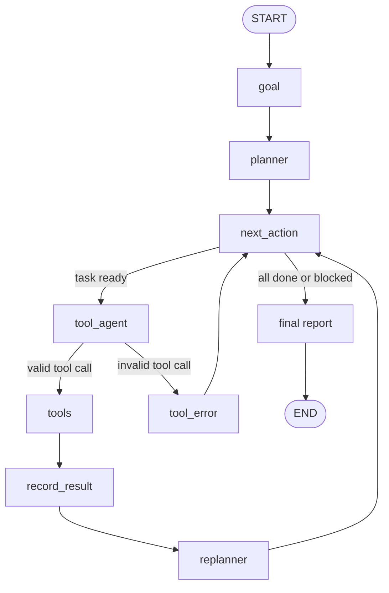

# Single Agent, Multi-Tool Call


A **LangGraph agent** that turns one natural-language request into a plan, calls the right tools in the right order, recovers when something fails, and delivers a clean, human-readable report.

**Demo task:** *"Is a Burj Khalifa (At The Top) visit worth it for 2 adults?"*
The agent checks live Dubai weather, searches ticket prices, fetches the AED to PKR exchange rate, calculates the budget and gives a recommendation with sources.

---

## Features

- **Goal, plan, execute loop**: extracts a structured goal, builds a task plan with dependencies, then runs tasks one by one.
- **Four tools**: live weather, web search, currency rate, and a safe arithmetic calculator.
- **Failure handling**: invalid plans are re-generated (up to 3 attempts), wrong tool calls are retried, failed tasks are marked and skipped, and the replanner runs only when a task fails.
- **Reliable numbers**: totals and currency conversion are calculated in Python, never by the LLM.
- **Grounded report**: ticket price and source URL must come from the actual search results; if no clear price is found, the report says so instead of guessing.
- **Professional output**: a fixed Markdown report (recommendation, weather, ticket price, budget, tips, sources).

## Architecture



| Node | What it does |
|---|---|
| `goal` | LLM extracts objective, requirements, constraints and context |
| `planner` | LLM creates a task plan (tool + dependencies); the plan is validated and retried up to 3 times |
| `next_action` | Picks the next ready task (an LLM call is used only when several tasks are ready at once) |
| `tool_agent` | LLM generates the tool call for the selected task |
| `tools` | Executes the real tool (LangGraph `ToolNode`) |
| `record_result` | Saves the result and flags failed tool outputs |
| `replanner` | Revises the remaining plan, but only when a task failed |
| `tool_error` | Retries a wrong or missing tool call, then marks the task as failed |
| `final` | LLM extracts facts and a decision; Python does the math and builds the report |

## Tools

| Tool | Purpose | Source |
|---|---|---|
| `get_dubai_weather` | Current temperature, feels-like, humidity, wind, conditions | OpenWeather |
| `search_web` | Ticket prices and source URLs | Tavily |
| `get_aed_to_pkr_rate` | Latest published AED to PKR rate and date | Frankfurter |
| `calculator` | Safe arithmetic (`+ - * /`) using an AST parser, no `eval` | Local |

## Tech stack

Python, LangGraph, LangChain, Google Gemini (`langchain-google-genai`), Pydantic, Tavily, OpenWeather, Frankfurter.

## Project structure

```
single-agent-multi-tool-call/
├── single-agent-multi-tool-call.ipynb   # the agent (run top to bottom)
├── requirements.txt
├── .env.example                         # copy to .env and add your keys
├── .gitignore
├── LICENSE
└── README.md
```

## Getting started

### 1. Get the API keys

| Key | Where to get it |
|---|---|
| `GOOGLE_API_KEY` | [Google AI Studio](https://aistudio.google.com) |
| `OPENWEATHER_API_KEY` | [OpenWeather](https://openweathermap.org/api) (new keys can take a while to activate) |
| `TAVILY_API_KEY` | [Tavily](https://tavily.com) |

### 2. Run locally

```bash
git clone https://github.com/umer-ameen-ml/single-agent-multi-tool-call.git
cd single-agent-multi-tool-call

python -m venv .venv
# Windows:  .venv\Scripts\activate
# macOS/Linux:  source .venv/bin/activate

pip install -r requirements.txt

cp .env.example .env        # Windows: copy .env.example .env
# open .env and paste your three keys

jupyter notebook single-agent-multi-tool-call.ipynb
```

Run the cells from top to bottom. The last cell runs the agent and prints the report.

### 3. Run on Kaggle

1. Upload the notebook.
2. In **Add-ons > Secrets**, add `GOOGLE_API_KEY`, `OPENWEATHER_API_KEY` and `TAVILY_API_KEY`, and attach them to the notebook.
3. Turn **Internet** on in the notebook settings.
4. Run all cells.

The notebook reads keys from Kaggle Secrets when available and falls back to a local `.env` file otherwise.

## Changing the model

The model is set in one cell:

```python
model = ChatGoogleGenerativeAI(
    model="gemini-3.5-flash-lite",
    google_api_key=google_key,
    max_retries=6,
)
```

Use any Gemini model that supports function calling. Free-tier request limits differ per model, so check the limits shown in Google AI Studio.

## Sample output

Output of a real run (trimmed):

> ### ⚠️ Recommendation: Yes, with conditions
> - Feels-like temperature reaches 37.84°C, requiring heat and sun precautions despite indoor observation decks.
> - Standard adult ticket prices start at AED 159.0 per adult, which is clearly identified from source material.
>
> | Metric | Value |
> |---|---:|
> | Temperature | 33.0 °C |
> | Feels like | 37.8 °C |
> | Humidity | 55% |
>
> | Calculation | Amount |
> |---|---:|
> | Price per adult | 159.00 AED |
> | Two tickets (159.00 × 2) | **318.00 AED** |
> | Exchange rate | 1 AED = 75.5530 PKR |
> | Total in PKR (318.00 × 75.5530) | **24,025.85 PKR** |

Prices and rates change over time, so your output will differ.

## Limitations

- Ticket prices come from web search snippets and can be a starting price or from a third-party seller. Always confirm on the official website before booking.
- Planning quality depends on the LLM. The code validates plans and retries, but a weak model can still produce poor plans.
- The demo is tied to Dubai and AED to PKR; the tools would need small changes for other cities or currencies.
- A run makes roughly 8 to 11 LLM calls, which matters on free-tier quotas.

## Troubleshooting

| Problem | Fix |
|---|---|
| `Key '$defs' is not supported in schema, ignoring` | A harmless warning from the Gemini integration; the nested task schema is still sent correctly. |
| `GOOGLE_API_KEY is missing` | Add the key to `.env` (local) or Kaggle Secrets, then re-run the keys cell. |
| Weather returns an error | A new OpenWeather key may need some time to activate. |
| `429` or quota errors | The Gemini free quota is used up. Wait for the reset or switch to a model with a higher free limit. |
| `ModuleNotFoundError` | Run `pip install -r requirements.txt`, then restart the kernel. |

## Roadmap

- Make the tools and prompts configurable for any city and currency
- Add automated tests with mocked tools and a fake LLM
- Add a command-line or Streamlit interface
- Add LangSmith tracing

## Author

**Umer Ameen**, AI/ML Engineer
[GitHub](https://github.com/umer-ameen-ml) · [LinkedIn](https://www.linkedin.com/in/umer-ameen-772919357) · [Hugging Face](https://huggingface.co/Umer0304)

## License

MIT, see [LICENSE](LICENSE).
